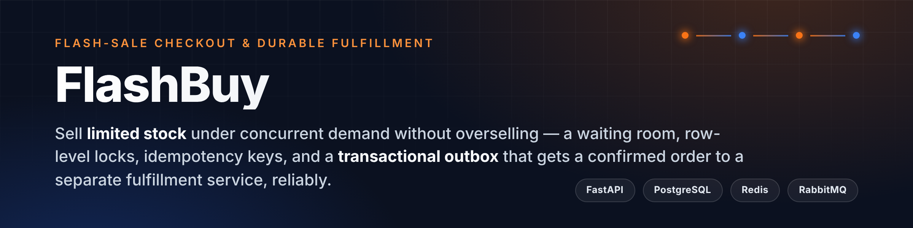
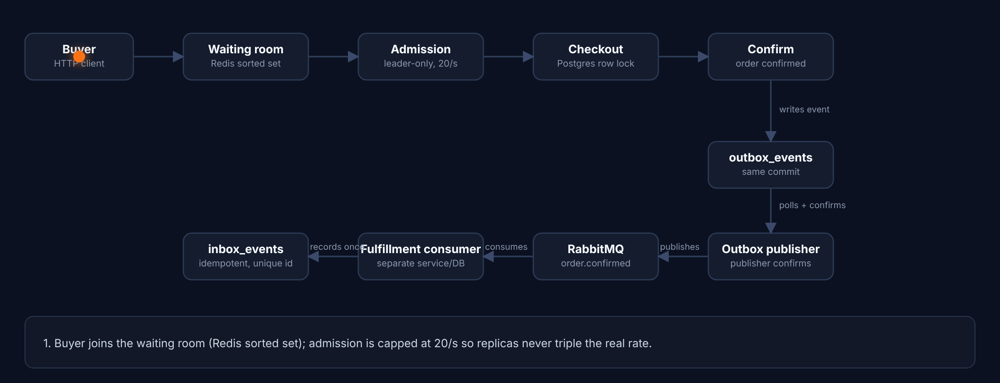

 

[Python service README](python-service/README.md) &nbsp;|&nbsp; [Results](python-service/README.md#results) &nbsp;|&nbsp; [Failure modes](python-service/docs/failure-modes.md) &nbsp;|&nbsp; [Engineering journal](python-service/docs/ENGINEERING_JOURNAL.md)

 

 

## &nbsp; What this is

This repository holds **two independent implementations** of the same
flash-sale checkout problem: sell a limited number of units under heavy
concurrent demand without overselling, using a waiting room, row-level locks,
idempotency keys, and reservation expiry — then, past the sale itself, get a
confirmed order to a completely separate fulfillment service **reliably**,
using a transactional outbox instead of a shared database.

The implementations are meant to be compared under **identical load-test
scenarios** (same journey, same stock, same Locust shape), so concurrency and
capacity behavior can be judged across stacks rather than as two unrelated
demos.

| Directory | Stack | Status |
| --- | --- | --- |
| [python-service/](python-service/) | FastAPI, PostgreSQL, Redis, RabbitMQ | Working implementation: tests, Docker Compose, Locust load tests, chaos-tested outbox, and a full write-up |
| [java-service/](java-service/) | Java | Placeholder, not implemented yet |

**Start with [python-service/README.md](python-service/README.md)** — it has
the architecture, how to run it, and every recorded result. Run Compose and
pytest from inside `python-service/` so paths in `docker-compose.yml` and the
Dockerfile stay relative to that service.

## &nbsp; Why this matters

Flash sales fail in a specific way. Thousands of people hit the same SKU in
the same second — a concert on-sale, a Black Friday drop, a console restock —
and a naive read-then-write path lets two transactions both see `stock > 0`
and both succeed, so the shop sells more units than it has. Fix that and the
database still can't absorb every concurrent checkout at once: connections,
lock waits, and query time pile up, and the site times out for everyone,
including people who would have gotten a unit. A waiting room that admits on
a drip, instead of letting everyone fight over the same row at once, is the
actual production answer — the same category of system as commercial virtual
waiting rooms (Queue-it and similar), just a small implementation of it, not
a competitor to them.

Past the sale, a second, quieter failure mode: once an order is confirmed, a
completely separate fulfillment service — its own database, no shared
transaction — has to find out, *reliably*, over a message broker. A plain
"write to the database, then publish to the queue" has a gap where the
process can crash between the two, silently losing the event. FlashBuy closes
that gap with a transactional outbox, and then actually breaks it on purpose
— killing the publisher, the consumer, and the broker mid-flight against real
containers — to find out if the design holds up, not just whether it compiles.

## &nbsp; The system at a glance

Everything left of the outbox is one service's transaction. Everything right
of it is a second, independent one that only ever hears about the first
through a durable, at-least-once event — never a shared table, never a
synchronous call it can block on.

## &nbsp; Principles

| Principle | In practice |
| --- | --- |
| **Prove it, don't assert it** | Every number in the results tables comes from a committed Locust run or a hand-run chaos drill, with the evidence file linked next to the claim |
| **Admit on a drip, not a poll** | Thousands of clients asking "am I admitted yet?" every second is a self-inflicted overload; FlashBuy pushes the token over SSE instead |
| **Atomic or it doesn't count** | The outbox write and the order-confirmed status change happen in the same commit, by construction, not by convention |
| **At-least-once, made safe** | Duplicate delivery is allowed and expected; the idempotent inbox is what turns it into a non-event instead of a duplicate job |
| **Break it on purpose** | Chaos tests kill the publisher, the consumer, and the broker against real containers, not mocks, and report what actually happened — bugs included |

## &nbsp; Verified gaps

Documenting a limitation honestly is part of the write-up, not a footnote.
Full detail: [python-service/docs/failure-modes.md](python-service/docs/failure-modes.md).

| Gap | Status |
| --- | --- |
| `outbox_events` and `inbox_events` grow without bound | **Fixed for the outbox side** — `app/outbox_retention.py`, tested against real Postgres (28/28 tests pass). `inbox_events` has the identical gap, not yet addressed. |
| The outbox publisher is safe today only because exactly one instance runs | **Not fixed** — documented as a scaling ceiling in the current design, not a bug in the system as it runs today. |

## &nbsp; License

MIT. See [LICENSE](LICENSE). `java-service` is a placeholder until the Java
implementation lands.

## &nbsp; Author

Swagat Subhash Kalita designs, builds, and load-tests FlashBuy.

[GitHub](https://github.com/swagatskalita092) &nbsp;|&nbsp; [LinkedIn](https://linkedin.com/in/swagat-s-kalita)
